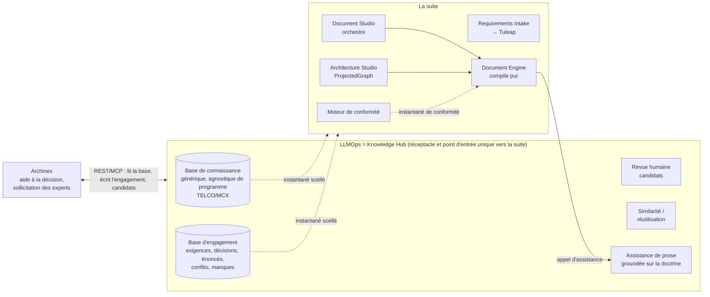

# Carte des composants : qui fait quoi, et par quelle interface

Contrat décrit : **1.40**. Dernière relecture : **24 octobre 2026** (relevé du code des deux côtés, voir « Historique des révisions » en fin de document).
Première version : 3 octobre 2026, révisée après la décision du mainteneur : **le Hub contient deux bases**, ADR-KH-01 A10, projet ; l'état du code qu'elle décrivait était celui du contrat 1.18.
Ce document décrit LLMOps (rôle « Knowledge Hub »), Archinex et les composants de la suite (Document Studio, Document Engine, etc.).
Chaque affirmation porte un niveau de preuve :

- **[lu]** : lu dans le code ou dans un texte du dépôt cité.
- **[ADR]** : dit par un ADR de la suite, dont certains sont encore *proposés* ; non vérifié dans le code du composant.
- **[décidé]** : décision du mainteneur du Hub (2026-10-03), en projet tant que l'ADR n'est pas adopté et que la suite n'a pas répondu.
- **[livré]** : implémenté dans ce dépôt et testé (contrat cité).
- **[déduit]** : mon inférence. À valider avec le propriétaire du composant.

Sources : `docs/plans/ALIGNEMENT-Document-Studio-Knowledge-Hub.md`, `docs/adr/ADR-KH-01-contrats-exposes.md` (A10),
`docs/adr/PROPOSITION-amendement-ADR-SUITE-05.md`, le code de ce dépôt et d'Archinex. **Lus le 2026-10-24** : `document-engine` (`4a9361b`), `Document-studio` (`85ba1e2`), `conformity-engine` (`63048a0`),
`requirements-intake` (`cadafc8`), `application-suite-portal` (`b409ba7`). **Toujours non lus** : Architecture Studio
(`four-level-design`), EDM, IP-flow, WBS et Tuleap ; ce que j'en dis vient des ADR et du registre de canaux. Aucun test de la suite
n'a été lancé pour cette relecture, sauf `make verify-suite` (code du Document Engine, voir §3).

## 1. Vue d'ensemble

Trait plein : appel direct. Trait pointillé : instantané scellé (fichier + empreinte), jamais d'appel en direct.
**Relevé du 2026-10-24** : aucun canal du Hub ne figure au registre de canaux de la suite (`contracts/channel-registry.json`, 16 canaux), et
Requirements Intake n'y est l'émetteur d'aucun canal vers le Document Engine : les exigences lui parviennent par l'instantané de conformité
(Tuleap → moteur de conformité → Document Engine). Les flèches `KB`/`ENG` → suite ci-dessus sont des **intentions**, pas des canaux branchés.
Le Hub émet **deux familles de canaux** : connaissance (existant) et engagement (nouveau, lot K11). La suite ne connaît pas Archinex.

## 2. Qui fait quoi

| Composant | Rôle | Détient | Ne fait pas | Preuve |
|---|---|---|---|---|
| **LLMOps (Knowledge Hub)** | Réceptacle des deux bases ; revue humaine ; similarité et réutilisation ; point d'entrée unique vers la suite | **Base de connaissance** (expérience d'experts sur un vertical, agnostique de programme) et **base d'engagement** (exigences, décisions, énoncés, conflits, manques d'un programme) | Prose de livrable ; prendre une décision (il enregistre celles que des personnes posent) ; modèle dans le chemin d'élicitation | [lu] code ; [décidé] A10 |
| **Archinex** | Outil d'aide à la décision et de sollicitation des experts : ingère l'appel d'offres, fait vivre le débat, fige des sections | Rien en propre à terme : un client du Hub. **Aujourd'hui** l'engagement est encore dans sa base Prisma (reprise : K12) | Génération de documents ; émission vers la suite | [lu] code Archinex ; [décidé] rôle cible |
| **Document Engine** | Compose un document : `compile(ProjectedGraph, Blueprint, GenerationContext)`, fonction pure ; snapshots externes en paramètres. Les exigences arrivent par un **instantané de conformité** scellé (ADR-DE-05), les décisions, hypothèses et risques par `ProjectedGraph.governanceStatements` (ADR-DE-44), les composants par `items[]` (couche obligatoire) | Le gabarit (Blueprint) et la composition | Ne détient pas de connaissance ; ne demande aucun « nœud de connaissance » ; n'appelle le LLM que pour assister des blocs de prose | [lu] README, ADR-DE-02, ADR-DE-05, ADR-DE-44, `types.ts` (`4a9361b`) |
| **Document Studio** | Orchestre ; « ne calcule jamais » | Le parcours de production | La composition (propriété du Document Engine) | [lu] `CLAUDE.md`, README |
| **Architecture Studio** | Produit le `ProjectedGraph` (éléments, couches, relations) | Le graphe d'architecture | — | [ADR] ; [lu] côté consommateur seulement |
| **Requirements Intake → Tuleap** | Prise en charge des exigences d'un appel d'offres côté suite | Les exigences de programme **côté suite** | — | [ADR], non lu |
| **Moteur de conformité** | Produit l'instantané de conformité | Les verdicts exigence → contrôle | — | [ADR], non lu |

Précisions :

- **Exigences** : deux endroits possibles, Hub (base d'engagement) et Requirements Intake. [décidé] Le Hub garde celles de
  l'appel d'offres pour l'instant : elles servent à solliciter les architectes et à leur faire expliciter leur savoir.
  La clarification avec la suite est en cours (question ouverte, §5).
- **Ingestion de l'appel d'offres** : faite côté Archinex avec un modèle ; ce qui en sort est marqué `llm-derived` et reste
  **proposé** ; seule une personne affirme. Le Hub reste déterministe (garantie D3-1). [décidé]
- **Prose** : le Document Engine compose de façon déterministe ; seul un bloc de prose peut recevoir une *suggestion* d'un
  LLM (Anthropic ou le Hub), jamais directement un contenu (ADR-DE-02). Un humain accepte. L'assistance de prose du Hub ne
  lit pas la base d'engagement et n'énonce rien sur le projet (A3-a, A10-d-4).

## 3. Natures d'interface

| Interface | Nature | État |
|---|---|---|
| Archinex ↔ LLMOps | REST (et MCP) : lecture de la base, candidats, similarité, confirmations de réutilisation, **écriture de l'engagement** (sujets, énoncés, questions, exigences, arbitrage). Contrat versionné (1.0 à 1.40), formes gelées dans `tests/contract/frozen/` | [livré] 1.14 (dépréciation levée), 1.16 (rôles), 1.17 (écriture), 1.37 (assertions signées), 1.39 (mode strict d'identité, désactivé par défaut) |
| LLMOps → suite (connaissance) | Instantané scellé (`scripts/export_sealed_snapshot.py`) | [livré] canonical-json v1, enveloppe de canal, versions citables et résolution (1.15, K1 à K3). Le contenu reste à plat (pas de wrapper `data`) : à valider avec la suite |
| LLMOps → suite (engagement) | Instantané scellé de la base d'engagement, `POST /api/engagements/{id}/exports` | [livré] 1.18 (K11) à 1.35 (schéma `1.8`) : enveloppe de la suite, identifiant dérivé du contenu, handles seulement, refus si la vérification échoue. **Consommateur de la suite non établi** [lu] : aucun lecteur dans les dépôts lus, aucun canal au registre. Son checksum est recalculé à l'identique par le code du Document Engine (`make verify-suite`) |
| LLMOps → Document Engine (conformité) | `GET /api/compliance/conformity-snapshot`, enveloppe `ExternalSnapshotEnvelope<ConformityData>` | [livré] côté Hub (1.30, 1.40) ; **refusée par le lecteur du Document Engine** [lu, mesuré] : provenance (`knowledge-hub` non admis, ADR-DE-41), puis version (2.0 émise, majeure 4 lue), `ref` absente, source de preuve hors vocabulaire fermé. Checksum identique. Voir §5.10 |
| Suite → LLMOps (propositions, K7) | Instantané scellé de propositions lu par `kb import-proposals` / `POST /api/knowledge/proposals/import` | [livré] côté Hub (1.33) ; **aucun émetteur trouvé** dans les dépôts de la suite lus [lu, recherche par mots-clés] |
| Document Engine → LLMOps | Assistance de prose : `POST /api/prose/suggest-batch`, groundée (PR #39) | Route [livré] côté Hub. **Aucun fournisseur Hub dans `document-engine` `4a9361b`** [lu] (PR `document-engine#32` non fusionnée) ; « l'assistance n'est pas un canal » [ADR] |
| Suite ↔ LLMOps (règle) | Canal à instantané scellé, **jamais de RPC** | [ADR] amendement du 2026-09-13, opposable |
| Archinex → suite | **Aucune** | [décidé] la suite ne connaît pas Archinex |

Chaque canal d'instantané porte une enveloppe commune (émetteur, empreinte SHA-256 au profil canonical-json v1,
`rebuiltByEmitterTest`), des références `knowledge-hub:<slug>` avec version, et une qualification épistémique à deux étages
(confiance par élément, `is_provisional` par instantané).

## 4. Séquence cible

| # | Étape | État |
|---|---|---|
| 1 | Base de connaissance vide, enrichie par Archinex (NIS2, etc.) | [lu] Archinex ingère par l'API LLMOps ; revue humaine avant canonisation |
| 2 | Soumission d'un appel d'offres via Archinex : exigences, sujets et manques extraits (proposés) → **base d'engagement du Hub** | [livré] côté Hub (K15 : `POST requirements`, `subjects`, `statements`) ; l'engagement existant d'Archinex reste à reprendre (K12) |
| 3 | Sollicitation des architectes : leurs réponses deviennent des énoncés attribués, la base éclaire les propositions, la réutilisation est confirmée hypothèse par hypothèse | [livré] côté Hub (K15 : questions, réponses, énoncés proposés puis affirmés par un autre membre) ; reste côté Archinex d'écrire dans le Hub |
| 4 | Capitalisation de décisions vers la base de connaissance : candidat revu par un humain, **sans ancre de programme** | [lu] chemin des candidats ; test d'étanchéité : K13 |
| 5 | Décisions propres au projet : restent dans la base d'engagement | [décidé] |
| 6 | Délibération, puis **le Hub émet l'instantané scellé d'engagement** vers la suite | [livré] K11 (rôle `admin`, K14) |
| 7 | Génération de documents | [lu] Document Engine, sur `ProjectedGraph` + snapshots ; via l'adaptateur LLMOps#40 |

## 5. Ce qui manque ou reste à établir

1. **Consommateur de l'instantané d'engagement** : le Document Engine prend un `ProjectedGraph` et un instantané de conformité
   (les exigences arrivent par ce dernier, ADR-DE-05), pas un dossier d'engagement. Il faut un adaptateur (LLMOps#40), propriétaire à
   désigner ; sa correspondance « décision → `governanceStatements` » est l'objet de LLMOps#153.
2. **Canal unique ou un canal par nature d'objet** (décisions, exigences, conflits, manques) : relève du registre de la suite.
   [déduit] des décisions vers Architecture Studio, des manques vers Requirements Intake, des conflits vers le moteur de
   conformité : à valider avec leurs propriétaires.
3. **Exigences** : Hub ou Requirements Intake / Tuleap, laquelle fait foi ? En clarification.
4. **L'émetteur d'un canal doit-il être un composant de la suite ?** Le Hub n'en est pas un (ADR-SUITE-05) ; à confirmer. Relevé du
   2026-10-24 : ADR-DE-41 (le Document Engine admet un **ensemble déclaré** de sources, jamais un littéral) est actée mais **pas
   implémentée** : `CONFORMITY_SOURCE_SYSTEM` est encore le scalaire `'tuleap'` (`src/conformity/types.ts`). L'admission de
   `knowledge-hub` est un amendement daté de cette ADR, à trois conditions (LLMOps#152).
5. **Maturité** : Archinex a `L5_archived`, la suite s'arrête à `L4_specified` ; à projeter vers `L4_specified` (archinex#31).
6. **Autorisation** : [livré] K9 (403, énumération filtrée, identifiants validés) et K14 (engagements gérés, fermés à tous sauf leurs membres, dans tous les environnements, rôles et journal d'accès). **Depuis 1.37 et 1.39** : assertions d'identité signées (EdDSA, JWKS publiée, anti-rejeu, durée bornée) et mode strict `LLMOPS_REQUIRE_SIGNED_ACTOR` qui refuse l'en-tête brut. Reste : le mode strict est **désactivé par défaut**, et le client (Archinex) doit signer (LLMOps#144). Tout engagement réel doit être **géré**.
7. **Transition** : [livré côté Hub] K12, contrat 1.20 : `POST /api/engagements/{id}/import` (simulation, provenance conservée, rien d'affirmé au nom du lot). Reste côté Archinex (archinex#34) : exécuter la reprise projet par projet puis basculer. Deux sources de vérité tant qu'un projet n'est pas basculé ; durée à borner avec l'équipe Archinex.
8. **Cascade de questions** : [livré côté Hub] K18, contrat 1.21 : les décisions affirmées portent des faits lisibles par machine (vocabulaire partagé de la base de connaissance, `GET /api/engagements/{id}/facts`). K19, contrat 1.22 : les règles de déclenchement (`data/kb/triggers`) vivent avec les actifs de la base de connaissance. K20, contrat 1.23 : le moteur déterministe du Hub ouvre des sujets dérivés (`GET …/lineage`, `PUT …/kb-pin`). K21, contrat 1.24 : chaque engagement désactive une règle (justification obligatoire) ou ajoute les siennes (`TRG-local-…`, affirmées par un autre décideur). K22, contrat 1.29 : les règles et les clés du vocabulaire entrent par le cycle des candidats (extraction hors ligne par un modèle local, revue humaine dans l'application d'administration, aperçu avec le même évaluateur que le moteur) (amorçage et revue des règles). Archinex extrait les faits (assisté) et affiche la cascade ; il n'ouvre aucun sujet lui-même.
7bis. **Le contenu de l'instantané d'engagement** est celui que le Hub détient : exigences (avec, depuis le contrat 1.27, la décision prise sur chacune et le sujet qui la porte), sujets, énoncés, **décisions avec options écartées, rationale et réversibilité (K16, contrat 1.19)**, conflits, manques. La **couverture exigence → contrôle** y est depuis le contrat 1.31 (K17 : `allocated` / `proposed` / `uncovered`, jamais vérifiée) et 1.35 (chaîne exigence ← sujet ← décision → actif → contrôle). **Ce n'est pas la couverture de la route `conformity-snapshot`** (§5.10) : deux sens, deux vocabulaires (`ConformityData` a huit statuts). Éléments d'architecture, journal de réutilisation, glossaire et documents sources, que le modèle `engagement_bundle` prévoyait, n'y sont pas (LLMOps#138). Ce qu'attend la suite (adaptateur vers `ProjectedGraph`, LLMOps#40) reste à établir.
7ter. **Archinex n'émet rien vers la suite** (directive du 2026-10-03) : son bundle et son figement scellé cessent d'être une source de la suite ; seul l'instantané du Hub l'est. Parité à atteindre : archinex#34.
7quater. **Le schéma 1.1 du bundle** (2026-10-13) est le **modèle de contenu cible** de cette parité, pas un canal : il décrit ce qu'il faudra retrouver dans l'instantané du Hub (audit des exigences d'un appel d'offres : état de chaque clause, motif, niveau d'affirmation, provenance). [décidé] Une exigence évacuée par une personne, avec son motif, est un fait engagé : elle ira dans le Hub (contrat 1.27, à venir). La proposition brute du modèle reste dans Archinex. Voir [`plans/PLAN-IMPLEMENTATION-Bundle-Engagement.md`](plans/PLAN-IMPLEMENTATION-Bundle-Engagement.md) §2.
8. **Contrôle de la prose en sortie** : vérifier que chaque affirmation chiffrée ou normative se retrouve dans les énoncés
   cités. Amorcé dans `pipelines/prose_grounding.py` ; l'endroit idéal est le pipeline du Document Engine (à confirmer).
9. **Statut des ADR** : ADR-KH-01 (PR #41, A10 incluse) et la proposition à ADR-SUITE-05 ne sont pas adoptés. Côté suite, ADR-SUITE-05 est **actée** avec deux amendements (2026-09-13 : un canal à instantané scellé, jamais de RPC ; l'assistance n'est pas un canal).
10. **Ce que le Document Engine refuse aujourd'hui de la route de conformité du Hub** [lu et mesuré le 2026-10-24, code `4a9361b`] : (a) la **provenance**, `'sourceSystem' attendu 'tuleap', reçu 'knowledge-hub'` ; puis, mesuré en expérience locale hors dépôt, (b) la **version** (majeure 4 lue, 2.0 émise), (c) l'absence de **`ref`** (`RequirementRef`, requise en majeure 4), (d) la **source de preuve** : `evidence[].source` est un vocabulaire fermé dont `knowledge-hub` ne fait pas partie. Le **checksum** est recalculé à l'identique. `make verify-suite` rejoue (a) et le checksum ; LLMOps#148, #150, #152.
11. **Identité d'une exigence** : la suite désigne une exigence par `RequirementRef {sourceId, requirementKey, version}` (`contracts/requirement-ref.md`), et le contrat dit que Tuleap est l'unique émetteur de `version`. Le Hub n'en émet aucune. Qui fait foi pour les exigences d'un appel d'offres (§5.3) conditionne la réponse (LLMOps#150).

## 6. Questions à poser aux propriétaires de la suite

- Registre de canaux : accepte-t-il un émetteur qui n'est pas un composant de la suite ? un canal « engagement » ?
- Architecture Studio : ses décisions de programme sont-elles les mêmes objets que celles délibérées avec les architectes ?
- Requirements Intake : l'exigence d'un appel d'offres du Hub et celle de Tuleap, laquelle fait foi ?
- Document Engine : qui écrit l'adaptateur vers `ProjectedGraph` ?
- Tous : confirmer la maturité `L5_archived` et la liste des canaux (16 au registre le 2026-10-24, dont aucun du Hub) qui concernent l'engagement.
- Document Engine : à quel lot d'exécution l'ensemble de sources d'ADR-DE-41 est-il prévu, et le vocabulaire fermé de `evidence[].source` peut-il admettre `knowledge-hub` ?
- Requirements Intake / Tuleap / moteur de conformité : le Hub est-il un registre d'exigences (`sourceId`) ou un relais (LLMOps#150) ?

## Historique des révisions

| Date | Contrat | Ce qui a changé |
|---|---|---|
| 2026-10-03 | 1.18 | Première version (décision A10 : deux bases dans le Hub). |
| 2026-10-24 | 1.40 | Relevé du code des deux côtés (voir « Sources »). Contrat 1.18 → 1.40 ; flèche Requirements Intake → Document Engine retirée (aucun canal) ; consommation réelle du Document Engine (ADR-DE-05, ADR-DE-44) ; refus mesurés de la route de conformité (§5.10) ; identité d'exigence (§5.11) ; ADR-DE-41 non implémentée ; assistance de prose sans fournisseur Hub ; K7 sans émetteur ; autorisation 1.37 et 1.39. Un test (`tests/unit/test_suite_map_version.py`) échoue si « Contrat décrit » diverge du contrat du code. |
